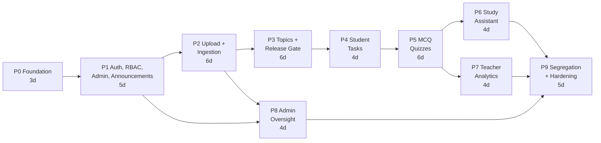

# Implementation Plan

## RAG-Powered Multi-Portal LMS — Phase-by-Phase Build Guide

| Field | Value |
|---|---|
| **Companion documents** | `prd.md`, `architecture.md` |
| **Purpose** | Executable, phase-gated plan for driving Cursor (or any coding agent) |
| **Document version** | 1.0 |
| **Last updated** | 2026-10-30 |
| **Total effort estimate** | ~47 dev-days (10 calendar weeks, 1 engineer) |

---

## 0. How to Use This Document

### 0.1 The loop

For each phase:

1. Create a branch: `feat/phase-<n>-<slug>`.
2. Open Cursor with `prd.md`, `architecture.md`, and this file in context.
3. Paste the phase's **Cursor prompt** (e.g., §3.6 for Phase 1) as the first message.
4. Let the agent produce a plan first. Reject the plan if it touches out-of-scope phases.
5. Implement, then run the phase's **Verification** commands.
6. Fill in the **Exit checklist**. Do not start the next phase until every box is checked.
7. Commit and tag: `git tag phase-<n>-done`.

### 0.2 Rules for the agent (repeat these in every prompt)

- Implement **only** the current phase. Do not scaffold future phases "for later".
- Never weaken or bypass the release gate (architecture §8.4, implementation §5.2) to make a test pass.
- Every schema change ships with an Alembic migration; never edit an applied migration.
- Every new mutating endpoint gets a test in the RBAC matrix.
- Do not add a dependency that is not listed in this phase.
- Do not change an existing API response shape without noting it in the summary.
- If a requirement is ambiguous, stop and ask; do not invent product behavior.

### 0.3 Phase map



| Phase | Name | Duration | Primary outcome | PRD requirements |
|---|---|---|---|---|
| P0 | Foundation | 3 d | One-command local stack, health checks, CI | §4 delivery |
| P1 | Identity, RBAC, Admin, Announcements | 5 d | Login works for 3 roles; admins manage users/courses; announcements feed | FR-AUTH, FR-ADM-01/03, FR-STU-01/02, FR-ANA-07 |
| P2 | Upload + Ingestion | 6 d | PDF → chunks → embeddings → Chroma, with status UI | FR-ING-01…12, FR-ADM-04/05 |
| P3 | Topics + Release Gate | 6 d | Auto topics, review UI, release/unrelease, **gate invariant** | FR-TOP-01…10, FR-ADM-07 |
| P4 | Student Tasks | 4 d | Multi-course task list with filters and completion | FR-STU-03…06, FR-STU-13, FR-NOT-01 |
| P5 | MCQ Quizzes | 6 d | Generation, teacher approval, attempt, grading, results | FR-QUIZ-01…07, FR-STU-09…12 |
| P6 | Study Assistant | 4 d | Grounded Q&A with citations and refusal | FR-STU-07/08, FR-NOT-02 |
| P7 | Teacher Analytics | 4 d | Cohort KPIs, student drill-down, knowledge gaps | FR-ANA-01…06 |
| P8 | Admin Oversight | 4 d | Audit log, permissions, content repo, bulk import | FR-ADM-02/06/08 (09 optional) |
| P9 | Segregation + Hardening | 5 d | Portal routing, a11y, load, security, docs | PRD §4, §10, §13 |

> **Phase numbering warning:** this document's phase numbers differ from the PRD's delivery phases. Always use the numbers in this document and say "implementation.md Phase N" when prompting Cursor, never "PRD Phase N". Mapping:
>
> | PRD delivery phase | Implementation phases |
> |---|---|
> | Phase 0 — Foundation | P0 |
> | Phase 1 — Unified portal skeleton | P1 (shell + admin/announcements), P4/P5 screens built incrementally |
> | Phase 2 — RAG ingestion & topics | P2 + P3 |
> | Phase 3 — Student execution | P4 + P5 + P6 |
> | Phase 4 — Analytics & admin oversight | P7 + P8 |
> | Phase 5 — Segregation & hardening | **P9** |

### 0.4 Data model by phase (migration order)

| Phase | Tables created | Tables altered |
|---|---|---|
| P0 | — (Alembic baseline only) | — |
| P1 | `users`, `courses`, `enrollments`, `announcements`, `announcement_reads`, `audit_logs`, `refresh_tokens` | — |
| P2 | `documents`, `ingestion_jobs`, `chunks` | — |
| P3 | `topics`, `tasks` | `chunks` + `topic_id`; `documents` + `topic_count`, `topics_source` |
| P4 | `task_progress`, `notifications` | — |
| P5 | `quizzes`, `questions`, `quiz_attempts`, `attempt_answers` | — (`quizzes.topic_id` references `topics`) |
| P6 | `rag_query_logs` | — |
| P7 | — (indexes only) | `users.last_active_at` index |
| P8 | `permissions` | — |
| P9 | — | — |

---

## 1. Global Conventions

### 1.1 Repository layout (concrete realization of architecture §6.1)

```
lms/
├── backend/
│   ├── app/
│   │   ├── main.py
│   │   ├── api/
│   │   │   ├── deps.py
│   │   │   ├── middleware.py
│   │   │   ├── errors.py
│   │   │   └── routers/
│   │   │       ├── auth.py
│   │   │       ├── users.py
│   │   │       ├── courses.py
│   │   │       ├── announcements.py
│   │   │       ├── documents.py
│   │   │       ├── topics.py
│   │   │       ├── student_tasks.py
│   │   │       ├── student_quiz.py
│   │   │       ├── teacher_quiz.py
│   │   │       ├── student_assistant.py
│   │   │       ├── teacher_analytics.py
│   │   │       ├── admin.py
│   │   │       └── notifications.py
│   │   ├── services/
│   │   ├── rag/
│   │   ├── workers/
│   │   ├── db/
│   │   │   ├── models.py
│   │   │   ├── repositories/
│   │   │   ├── base.py
│   │   │   └── migrations/versions/
│   │   ├── core/
│   │   │   ├── config.py
│   │   │   ├── security.py
│   │   │   ├── scope.py
│   │   │   └── logging.py
│   │   ├── seed.py
│   │   └── cli.py
│   ├── tests/
│   │   ├── conftest.py
│   │   ├── fixtures/
│   │   └── test_*.py
│   ├── eval/
│   ├── pyproject.toml
│   ├── alembic.ini
│   └── Dockerfile
├── web/
│   ├── app/
│   ├── components/
│   ├── lib/
│   ├── middleware.ts
│   ├── package.json
│   └── Dockerfile
├── infra/
│   └── docker-compose.yml
├── load/
│   └── k6.js
├── scripts/
│   ├── dev.ps1
│   └── dev.sh
├── .github/workflows/ci.yml
├── .env.example
├── .gitignore
├── prd.md
├── architecture.md
├── implementation.md
└── README.md
```

### 1.2 Naming and style

| Concern | Rule |
|---|---|
| Python | 3.12, full type hints, `ruff format` + `ruff check`, `mypy --strict` on `app/` |
| SQL | SQLAlchemy 2.0 async, `Mapped[...]` style, snake_case tables/columns |
| API | `/api/v1`, plural nouns, `snake_case` JSON, RFC 7807 errors |
| TS | strict mode, no `any`, server state via TanStack Query, forms via react-hook-form + zod |
| Components | PascalCase files for components, kebab-case route folders |
| Commits | `feat(scope): …`, `fix(scope): …`, `test(scope): …`, `chore(scope): …` |
| IDs | UUIDv7 (time-sortable) for all primary keys |

### 1.3 Standard commands

```powershell
# start everything
docker compose --env-file .env -f infra/docker-compose.yml up -d --build

# migrate + seed
docker compose --env-file .env -f infra/docker-compose.yml exec api alembic upgrade head
docker compose --env-file .env -f infra/docker-compose.yml exec api python -m app.seed

# quality gates
docker compose --env-file .env -f infra/docker-compose.yml exec api ruff check app tests
docker compose --env-file .env -f infra/docker-compose.yml exec api mypy app
docker compose --env-file .env -f infra/docker-compose.yml exec api pytest -q
docker compose --env-file .env -f infra/docker-compose.yml exec web npm run lint
docker compose --env-file .env -f infra/docker-compose.yml exec web npm run build
```

`scripts/dev.ps1` wraps these (`dev.ps1 up|migrate|seed|test|lint|fmt|logs`).

### 1.4 Global Definition of Done (every phase)

- [ ] Migrations apply cleanly from an empty database and roll back one step.
- [ ] Seed script remains idempotent (`python -m app.seed` twice = same state).
- [ ] New endpoints documented in OpenAPI with request/response examples.
- [ ] New endpoints covered by the RBAC matrix test.
- [ ] `ruff`, `mypy`, `pytest`, `npm run lint`, `npm run build` all pass.
- [ ] No secrets committed; `.env.example` updated for new keys.
- [ ] README "Current state" section updated with what now works.
- [ ] Phase exit checklist complete.

### 1.5 Test data

- `backend/tests/fixtures/mini.pdf` — 3-page synthetic PDF generated once (checked in).
- Manual ingestion tests use `hesc103.pdf` (smallest real NCERT file, ~780 KB).
- Never commit generated embeddings or `data/` volumes.

---

## 2. Phase 0 — Foundation

**Goal:** a running skeleton where `docker compose up` yields six healthy services, migrations run, and CI is green. No product features.

**Duration:** 3 days.

### 2.1 Deliverables

| Area | Files |
|---|---|
| Infra | `infra/docker-compose.yml`, `backend/Dockerfile`, `web/Dockerfile`, `.dockerignore` |
| Backend | `backend/pyproject.toml`, `app/main.py`, `app/core/config.py`, `app/core/logging.py`, `app/api/errors.py`, `app/api/middleware.py`, `app/db/base.py`, `alembic.ini`, baseline migration |
| Frontend | Next.js 15 scaffold, Tailwind, shadcn init, root layout, placeholder home |
| Tooling | `.env.example`, `.gitignore`, `.gitattributes`, `scripts/dev.ps1`, `scripts/dev.sh`, `Makefile`, `.github/workflows/ci.yml`, `README.md` |
| Tests | `tests/test_health.py`, `tests/conftest.py` |

### 2.2 Tasks

1. **Repo init.** `git init`, `.gitignore` (Python, Node, `.env`, `data/`, `.venv`, `__pycache__`, `.next`), `.gitattributes` (`* text=auto eol=lf`).
2. **Backend package.** `pyproject.toml` with: `fastapi`, `uvicorn[standard]`, `sqlalchemy[asyncio]`, `asyncpg`, `alembic`, `pydantic-settings`, `structlog`, `python-multipart`, `httpx`, `orjson`, `uuid6`, `arq`, `redis`; dev: `pytest`, `pytest-asyncio`, `pytest-cov`, `ruff`, `mypy`, `testcontainers`, `reportlab`. Use `uv` (`uv sync`) with a `pip` fallback documented.
3. **Config.** `core/config.py` — `Settings(BaseSettings)` exposing every key in architecture Appendix A, `model_config = SettingsConfigDict(env_file=".env", extra="ignore")`, and a `validate_runtime()` that raises on missing `DATABASE_URL`/`SESSION_SECRET` in non-test envs.
4. **Logging + request IDs.** `structlog` JSON renderer; middleware assigns `request_id` (accept inbound `X-Request-ID`), binds it to context, logs method/path/status/duration.
5. **Errors.** `ProblemDetail` exception + handlers for `HTTPException`, `RequestValidationError`, unhandled exceptions; every response carries `request_id`.
6. **Health.** `GET /healthz` (process alive), `GET /readyz` (checks Postgres + Redis; Chroma check added in P2).
7. **DB base.** Async engine from `DATABASE_URL`, `async_sessionmaker`, `get_session` dependency, declarative `Base` with `id`/`created_at`/`updated_at` mixins.
8. **Alembic.** Async template, `env.py` reads `Settings`, baseline revision `0001_baseline` (no tables).
9. **Docker Compose.** Services: `postgres:16`, `redis:7-alpine`, `chromadb/chroma`, `api`, `worker` (same image, command `arq app.workers.settings.WorkerSettings` — worker package can be a stub in P0), `web`. Named volumes: `pg-data`, `chroma-data`, `model-cache`, `uploads`.
10. **Frontend scaffold.** `create-next-app` (TS, Tailwind, App Router, no src dir), shadcn init, base layout with app name, `/` redirects to `/login` (placeholder page).
11. **CI.** `.github/workflows/ci.yml`: backend (ruff, mypy, pytest with service containers for pg/redis/chroma), frontend (lint, build).
12. **README.** Prereqs, one-command start, ports, env setup, troubleshooting.
13. **Cursor rules.** Create `.cursor/rules/lms.mdc` from Appendix A so every later prompt inherits the non-negotiables.

### 2.3 Contracts

```
GET /healthz  → 200 {"status":"ok","version":"0.1.0"}
GET /readyz   → 200 {"postgres":"ok","redis":"ok"} | 503 {"postgres":"fail",...}
Error shape   → {"type":"https://lms/errors/validation","title":"Validation failed",
                 "status":422,"detail":"…","request_id":"…"}
```

Ports: web `3000`, api `8000`, postgres `5432`, redis `6379`, chroma `8001`.

### 2.4 Verification

```powershell
docker compose --env-file .env -f infra/docker-compose.yml up -d --build
docker compose --env-file .env -f infra/docker-compose.yml ps            # all healthy
curl http://localhost:8000/healthz
curl http://localhost:8000/readyz
docker compose --env-file .env -f infra/docker-compose.yml exec api alembic upgrade head
docker compose --env-file .env -f infra/docker-compose.yml exec api alembic downgrade -1
docker compose --env-file .env -f infra/docker-compose.yml exec api alembic upgrade head
docker compose --env-file .env -f infra/docker-compose.yml exec api pytest -q
```

### 2.5 Do not

- Do not create product tables yet.
- Do not add `sentence-transformers`/`chromadb` Python clients yet (image size) — P2 adds them.
- Do not build auth or UI beyond a placeholder.

### 2.6 Cursor prompt

```
Read prd.md and architecture.md (§5, §6, §7, §17, Appendix A) plus implementation.md §2.
Implement ONLY Phase 0 (Foundation). No product features.

Build:
1. Monorepo layout exactly as implementation.md §1.1.
2. backend/pyproject.toml with the Phase 0 dependencies listed in §2.2.2.
3. app/core/config.py reading every env var in architecture.md Appendix A, failing fast on missing DATABASE_URL/SESSION_SECRET outside tests.
4. structlog JSON logging + request_id middleware + RFC7807 error handlers.
5. GET /healthz and GET /readyz (postgres + redis checks).
6. SQLAlchemy async base/session and an Alembic baseline migration with no tables.
7. infra/docker-compose.yml with postgres, redis, chroma, api, worker (stub), web; named volumes; healthchecks.
8. Next.js 15 + TS + Tailwind + shadcn scaffold with a placeholder login page.
9. scripts/dev.ps1, Makefile, .env.example, .gitignore, .gitattributes, README, GitHub Actions CI (ruff, mypy, pytest, npm lint+build).
10. tests/test_health.py and tests/conftest.py.
11. .cursor/rules/lms.mdc using implementation.md Appendix A.

Constraints: Python 3.12, async SQLAlchemy, no secrets in code, no product tables, no auth yet.
Before coding, list the files you will create. Then implement.
Verify with: docker compose up, /healthz, /readyz, alembic upgrade/downgrade/upgrade, pytest.
Report: files created, commands run, test output, anything blocked.
```

### 2.7 Exit checklist

- [ ] Six containers healthy, restart-safe (down/up preserves data).
- [ ] `/readyz` fails correctly when Postgres is stopped.
- [ ] Migration round-trip works.
- [ ] CI green on a fresh clone.
- [ ] `README` gets a newcomer from clone → running app in < 10 minutes.

---

## 3. Phase 1 — Identity, RBAC, Courses, Announcements

**Goal:** three roles can log in and land in their portal; admins manage users and courses; announcements publish to a cohort.

**Duration:** 5 days.

### 3.1 Deliverables

| Area | Files |
|---|---|
| DB | `users`, `courses`, `enrollments`, `announcements`, `announcement_reads`, `audit_logs`, `refresh_tokens` + migration |
| Security | `core/security.py` (Argon2id, JWT issue/verify, CSRF), `core/scope.py` (`CourseScope`) |
| Routers | `auth.py`, `users.py`, `courses.py`, `announcements.py` |
| Services | `auth_service.py`, `user_service.py`, `course_service.py`, `announcement_service.py`, `audit_service.py` |
| Repositories | `users.py`, `courses.py`, `enrollments.py`, `announcements.py` |
| Web | `/login`, `(student|teacher|admin)` layouts, sidebar, admin users table, courses page, announcements composer/feed |
| Tests | `test_auth.py`, `test_rbac_matrix.py`, `test_courses.py`, `test_announcements.py` |
| Seed | 1 admin, 3 teachers, 30 students, 2 courses, enrollments |

### 3.2 Tasks

1. **Models + migration.** `users(id, name, email unique, password_hash, role enum, status, last_active_at)`, `courses(id, code unique, title, term, description, created_by, status)`, `enrollments(course_id, user_id, course_role)` PK composite, `announcements(id, course_id nullable, author_id, title, body, publish_at, expires_at)`, `announcement_reads(user_id, announcement_id, read_at)`, `audit_logs(...)`, `refresh_tokens(id, user_id, token_hash, expires_at, revoked_at)`.
2. **Password hashing.** Argon2id via `argon2-cffi` with tuned parameters; `needs_rehash` on login.
3. **Tokens.** Access JWT (15 min) with `sub`, `role`, `jti`; refresh token opaque 256-bit, stored hashed, rotated on use, revocable. Cookies: `httpOnly`, `Secure` (except local), `SameSite=Lax`, paths `/`.
4. **CSRF.** Double-submit: `csrf_token` cookie (non-httpOnly) + `X-CSRF-Token` header required on POST/PATCH/DELETE.
5. **Auth endpoints.** `POST /auth/login` (rate limited: 5/min/IP, 10/hour/account), `POST /auth/logout`, `POST /auth/refresh`, `GET /me`.
6. **Dependencies.** `get_current_user` (verifies JWT, loads user, rejects inactive), `require_role(*roles)`, `get_course_scope(user)` returning enrolled course IDs for students and owned/assigned IDs for teachers.
7. **`CourseScope`.** Frozen dataclass `{course_ids: frozenset[UUID], role: Role}`; repositories accept it and inject `WHERE course_id IN :scope`. Type-level requirement: no student-facing repo method accepts a bare `course_id`.
8. **Admin users API.** List (search, role filter, pagination), create (temp password), patch (name/role/status), delete (soft). Role change writes audit.
9. **Courses API.** CRUD + enroll/unenroll; teacher can read own courses; admin sees all.
10. **Announcements API.** Create/update/delete (teacher for own courses, admin global), publish window, student feed filtered by enrollment and `publish_at <= now < expires_at`.
11. **Audit.** `audit_service.record(actor, action, entity, before, after, request_id)`; called from admin mutations and logins (failures too).
12. **Seed.** Idempotent upserts; passwords from env (`SEED_ADMIN_PASSWORD` default `ChangeMe123!`); print a credentials table plus seeded course IDs at the end (P2 CLI uses them); add the seed keys to `.env.example`.
13. **Web.** Login page with error states; role-based redirect (`/admin/users`, `/teacher/documents`, `/student/dashboard`); shared shell (header, sidebar, user menu); admin users table with create/edit drawer; courses page; announcements page with composer and preview.
14. **Route guard (UX only).** `middleware.ts` reads a non-sensitive `lms_role` cookie for redirects; API remains authoritative.
15. **Tests.** RBAC matrix parametrized over every route × role (expect 401/403/200); login lockout; refresh rotation; announcement visibility across two courses; enrollment scoping.

### 3.3 Contracts

```http
POST /api/v1/auth/login      {"email","password"} → 200 {"user":{...}} + Set-Cookie
POST /api/v1/auth/logout     → 204
POST /api/v1/auth/refresh    → 200 (rotates refresh)
GET  /api/v1/me              → 200 {"id","name","email","role","courses":[...]}

GET    /api/v1/admin/users?role=student&search=&cursor=&limit=
POST   /api/v1/admin/users   {"name","email","role","course_ids":[]}
PATCH  /api/v1/admin/users/{id}  {"name?","role?","status?"}
DELETE /api/v1/admin/users/{id}

GET/POST      /api/v1/courses
PATCH/DELETE  /api/v1/courses/{id}
POST          /api/v1/courses/{id}/enrollments   {"user_ids":[]}
DELETE        /api/v1/courses/{id}/enrollments/{user_id}

GET/POST      /api/v1/announcements
PATCH/DELETE  /api/v1/announcements/{id}
```

Cookie names: `lms_access`, `lms_refresh`, `lms_csrf`, `lms_role`.

### 3.4 Verification

```powershell
docker compose --env-file .env -f infra/docker-compose.yml exec api alembic upgrade head
docker compose --env-file .env -f infra/docker-compose.yml exec api python -m app.seed
docker compose --env-file .env -f infra/docker-compose.yml exec api pytest tests/test_auth.py tests/test_rbac_matrix.py tests/test_courses.py tests/test_announcements.py -q
```

Manual: log in as each seeded role; confirm redirect; as student, `curl -X POST /api/v1/admin/users` → 403; create an announcement for Course A and confirm a Course B student does not see it.

### 3.5 Do not

- Do not implement documents, RAG, tasks, or quizzes.
- Do not trust the `lms_role` cookie for authorization.
- Do not store refresh tokens in plaintext.
- Do not allow self-registration.

### 3.6 Cursor prompt

```
Read prd.md §5.1/5.2/5.5, architecture.md §8.2, §11.2, §13, and implementation.md §3.
Implement ONLY Phase 1.

Scope:
- Tables: users, courses, enrollments, announcements, announcement_reads, audit_logs, refresh_tokens (Alembic migration).
- Argon2id passwords; JWT access 15m + rotating opaque refresh in httpOnly cookies; CSRF double-submit.
- Endpoints exactly as implementation.md §3.3.
- Dependencies: get_current_user, require_role, get_course_scope; CourseScope dataclass; repositories require CourseScope for student-facing reads.
- Admin user CRUD + course CRUD + enrollments + announcements with publish windows.
- Audit log writes for admin mutations and login failures.
- Next.js: login, shared shell, admin users table, courses page, announcements composer/feed, role-based redirect.
- Seed: 1 admin, 3 teachers, 30 students, 2 courses, enrollments; idempotent.
- Tests: test_auth.py, test_rbac_matrix.py, test_courses.py, test_announcements.py.

Hard constraints:
- Every mutating endpoint appears in the RBAC matrix test.
- Student-facing queries never accept a raw course_id; they use CourseScope.
- Middleware redirects are UX only; the API enforces authorization.
- No documents/tasks/quizzes/RAG in this phase.

Verify: alembic upgrade head, seed twice, pytest, manual login for all three roles.
Report: files, endpoints, test output, any deviation from the contract.
```

### 3.7 Exit checklist

- [ ] All three roles log in, log out, and refresh without re-login loops.
- [ ] RBAC matrix covers 100% of mutating routes.
- [ ] A student cannot read another course's announcements.
- [ ] Audit rows exist for user create/role change/login failure.
- [ ] Seed is idempotent.

---

## 4. Phase 2 — PDF Upload + Ingestion Pipeline

**Goal:** upload a PDF, watch it move through extraction/chunking/embedding, and end with vectors in Chroma. No topics yet.

**Duration:** 6 days.

### 4.1 Deliverables

| Area | Files |
|---|---|
| DB | `documents`, `ingestion_jobs`, `chunks` + migration |
| RAG | `rag/extract.py`, `rag/chunker.py`, `rag/embedder.py`, `rag/vector_store.py` |
| Services | `document_service.py`, `storage.py` (local/S3 adapter) |
| Worker | `workers/settings.py`, `workers/ingest.py` |
| Routers | `documents.py` |
| CLI | `app/cli.py` (`ingest`, `reindex`, `vector-stats`) |
| Web | `/teacher/documents` upload + list + status polling |
| Tests | `test_chunker.py`, `test_extract.py`, `test_ingest.py`, `test_documents_api.py` |

### 4.2 Tasks

1. **Dependencies.** Add `chromadb`, `sentence-transformers`, `pymupdf`, `tenacity` (`arq`/`redis` already installed in P0); create `backend/Dockerfile` stage that pre-downloads the MiniLM model into `HF_HOME=/models` (baked into the image, not fetched at runtime).
2. **Models.** `documents(id, course_id, uploaded_by, filename, checksum, size_bytes, page_count, status, error_code, error_detail, pipeline_version, topic_count, deleted_at)`; `ingestion_jobs(id, document_id, stage, progress_pct, attempts, started_at, finished_at, error)`; `chunks(id, vector_id unique, document_id, course_id, topic_id nullable, chunk_index, text, page_start, page_end, section_title, token_count, released default false)`.
3. **Storage adapter.** `Storage` protocol with `put(key, bytes) -> str`, `open(key) -> BinaryIO`, `delete(key)`, `signed_url(key, ttl)`. Local implementation writes to `UPLOAD_DIR`; S3 implementation behind the same interface (config switch).
4. **Upload endpoint.** `POST /documents` (multipart, `course_id`); teacher must own course. Validate: extension + magic bytes `%PDF-`, ≤ 50 MB, not encrypted, page count ≤ 1000. Compute SHA-256; duplicate in course → `409` with existing ID. Store, insert rows, enqueue job, return `202`.
5. **Extraction.** `extract_pdf(bytes) -> Document{page_count, pages:[{page_no, text, headings:[{level,text}]}]}` using PyMuPDF; detect headings by font size/bold relative to body; flag `no_text_layer` if < 50 chars across the doc.
6. **Chunker.** `chunk_document(doc, tokenizer, max_tokens=600, overlap=90)`:
   - split on headings into sections;
   - pack sentences into windows, never split mid-sentence;
   - overlap by sentences until ≈90 tokens;
   - drop chunks < 40 tokens unless the only chunk in a section;
   - output `page_start/page_end/section_title/token_count/index`.
7. **Embedder.** Lazy singleton (`lru_cache`) loading `all-MiniLM-L6-v2`; `encode(texts, batch_size=64, normalize_embeddings=True)`; assert `dim == 384`.
8. **Vector store adapter.** `upsert(chunks, embeddings)`, `query(vector, where, top_k, include)`, `update_metadata(ids, metadatas)`, `delete(where|ids)`, `count()`. Create collection with `{"hnsw:space":"cosine"}` if absent. Embed `section_title + "\n" + text`; store raw `text` as the document.
9. **Ingest job.** ARQ `ingest_document(ctx, document_id)` with stage checkpoints in `ingestion_jobs`: `extracting → chunking → embedding → indexed`. Update `progress_pct` per batch. Idempotent: deterministic vector IDs `"{document_id}:{chunk_index}"`; delete existing vectors for the document before upsert on retry. 3 retries with backoff; typed `error_code`s (`ENCRYPTED_PDF`, `NO_TEXT_LAYER`, `VECTOR_WRITE_FAILED`, `PARSE_FAILED`).
10. **Status endpoints.** `GET /documents?course_id=`, `GET /documents/{id}`, `GET /documents/{id}/status`, `POST /documents/{id}/retry`, `DELETE /documents/{id}` (soft delete + vector delete + storage delete).
11. **CLI.** `python -m app.cli ingest <path> --course-id <uuid> --user-email <email>` runs the same service path synchronously (for debugging without the UI).
12. **Web.** Upload dropzone with per-file progress; document table with status badge, page count, chunk count, retry button; polling every 2 s while any document is non-terminal.
13. **Tests.** Chunker property tests (page spans monotonic, overlap present, no mid-sentence cut, token bounds); extraction on `mini.pdf`; integration ingest asserts chunk rows + Chroma count match; re-ingest is idempotent (same count); encrypted PDF → `ENCRYPTED_PDF`; duplicate upload → 409; non-owner teacher → 403.
14. **Reconciliation stub.** `reconcile_vectors` job comparing `chunks` rows to Chroma IDs; log drift (full repair logic lands in P3).

### 4.3 Contracts

```http
POST   /api/v1/documents            multipart: file, course_id → 202 {"document_id","status":"queued"}
GET    /api/v1/documents?course_id=&status=
GET    /api/v1/documents/{id}
GET    /api/v1/documents/{id}/status → {"stage":"embedding","progress_pct":62,"error_code":null}
POST   /api/v1/documents/{id}/retry  → 202
DELETE /api/v1/documents/{id}        → 204
```

Document status enum: `queued, extracting, chunking, embedding, indexed, topic_extraction, ready, failed`.

Chunk metadata in Chroma (all scalar):

```json
{"course_id":"…","document_id":"…","topic_id":"unassigned","page_start":12,"page_end":14,
 "section_title":"Chemical Reactions","released":false,"pipeline_version":1,"chunk_index":4}
```

### 4.4 Verification

```powershell
# unit + integration
docker compose --env-file .env -f infra/docker-compose.yml exec api pytest tests/test_chunker.py tests/test_extract.py tests/test_ingest.py -q

# real-world smoke test
docker compose --env-file .env -f infra/docker-compose.yml cp hesc103.pdf api:/tmp/hesc103.pdf
docker compose --env-file .env -f infra/docker-compose.yml exec api python -m app.cli ingest /tmp/hesc103.pdf --course-id <seeded-course-id> --user-email teacher1@lms.example.com
docker compose --env-file .env -f infra/docker-compose.yml exec api python -m app.cli vector-stats
```

Expect: ~150 pages, several hundred chunks, `status=indexed`, Chroma count == chunk count.

### 4.5 Do not

- Do not call Groq in this phase.
- Do not create topics or tasks.
- Do not mark any chunk `released`.
- Do not load the embedding model at API startup (worker only).

### 4.6 Cursor prompt

```
Read prd.md §5.3, architecture.md §8.3/8.5, §9.1, §12, and implementation.md §4.
Implement ONLY Phase 2 (upload + ingestion). No LLM calls, no topics, no release.

Build:
1. Migration for documents, ingestion_jobs, chunks.
2. Storage adapter (local + S3 interface) and upload validation (magic bytes, size, encryption, page cap, checksum dedupe).
3. rag/extract.py (PyMuPDF, headings, page text, no-text-layer detection).
4. rag/chunker.py with the exact rules in implementation.md §4.2.6.
5. rag/embedder.py using sentence-transformers/all-MiniLM-L6-v2, normalized, batch 64, dim assert.
6. rag/vector_store.py Chroma adapter (upsert/query/update_metadata/delete/count) with cosine space and scalar metadata.
7. ARQ worker + ingest_document job with stage checkpoints, deterministic vector ids, retries, typed error codes.
8. Document endpoints + CLI (ingest, reindex, vector-stats).
9. Teacher documents page with upload, progress polling, retry.
10. Tests: chunker properties, extraction, end-to-end ingest with Chroma, idempotent re-ingest, encrypted PDF, duplicate 409, non-owner 403.

Constraints:
- Chroma via HTTP client (server mode), never embedded PersistentClient.
- Embedding model loads only inside the worker.
- Every chunk starts released=false.
- Document status must end at "indexed" (topic stages come in Phase 3).

Verify: pytest, then ingest hesc103.pdf via CLI and confirm Chroma count == chunks count.
Report: files, schema, chunk count for the real PDF, timings, deviations.
```

### 4.7 Exit checklist

- [ ] 200-page PDF ingests in < 5 min locally.
- [ ] Chunk count in Postgres equals Chroma count.
- [ ] Re-running ingestion produces no duplicates.
- [ ] Encrypted/corrupt PDFs fail with a human-readable code.
- [ ] Upload progress UI reflects real stages.

---

## 5. Phase 3 — Topics, Selective Release, and the Gate

**Goal:** turn indexed chunks into a reviewable topic list, let teachers edit and release them, and prove the release gate holds.

**Duration:** 6 days. **This is the highest-risk phase; do not rush it.**

### 5.1 Deliverables

| Area | Files |
|---|---|
| DB | `topics`, `tasks`; `chunks.topic_id`; `documents.topic_count`, `documents.topics_source` + migration |
| RAG | `rag/topics.py` (extraction, schema validation, heading fallback), `rag/prompts/topics_v1.txt` |
| Services | `topic_service.py` (edit/merge/split/release), `task_service.py` (creation only) |
| Worker | `workers/ingest.py` gains `topic_extraction`; `workers/scheduled.py` reconcile job |
| Routers | `topics.py` |
| Web | `/teacher/documents/[id]/topics` review UI; student preview drawer |
| Tests | `test_topics.py`, `test_release_gate.py`, `test_vector_reconcile.py` |

### 5.2 Tasks

1. **Dependency.** Add the `groq` SDK. Missing `GROQ_API_KEY` must fail the extraction stage (with fallback), not app startup.
2. **Migration.** `topics(id, document_id, course_id, title, summary, page_start, page_end, order_index, release_state enum(draft|released|scheduled), released_by, released_at, deleted_at)`; `tasks(id, topic_id, course_id, title, description, week_no, due_at, status enum(draft|published|archived))`; add `chunks.topic_id` (the `released` flag already exists from P2 and stays `false` for every chunk until release); `documents.topic_count`, `documents.topics_source enum(llm|fallback)`.
3. **Topic extraction.** Build outline (chunk id, section title, first 200 chars) bounded to ~12k tokens; map-reduce if larger. Groq call with strict JSON schema, `temperature=0.1`, 2 retries. Validate: unique titles, page ranges inside document, every `chunk_id` exists, coverage ≥ 90%. Unmapped chunks attach to nearest topic and get `needs_review=true` in the summary metadata.
4. **Heading fallback.** If Groq is unavailable or schema fails twice, group by top-level headings; split sections > 25 pages; mark document `topics_source=fallback` so the UI can warn.
5. **Persistence.** Insert topics `draft`; assign `chunks.topic_id`; set `chunks.released=false`; update `documents.topic_count`; status → `ready`.
6. **Topic API.** `GET /documents/{id}/topics`, `PATCH /topics/{id}` (title/summary/page range/order), `POST /topics/merge` (`{topic_ids, title}`), `POST /topics/{id}/split` (`{at_chunk_id, new_title}`), `DELETE /topics/{id}` (draft only), `GET /topics/{id}/preview` (chunks + student-view payload).
7. **Release.** `POST /topics/{id}/release` body `{week_no, due_at, generate_quiz: false}`:
   - authorize teacher owns course; topic must be `draft` (or `released` for idempotent no-op);
   - transaction: `topics.release_state='released'`, insert `tasks` (`published`), `UPDATE chunks SET released=true WHERE topic_id=…`, audit row;
   - after commit: `vector_store.update_metadata(ids, [{"released": True}, …])`;
   - enqueue reconcile job on Chroma failure; return task ID.
8. **Unrelease.** `POST /topics/{id}/unrelease` — reverse state, archive task, set `chunks.released=false`, Chroma update after commit. Preserve `task_progress` rows (P4) for history.
9. **Reconcile job.** Hourly: diff `chunks.released` vs Chroma metadata for recent topics; repair drift; emit metric `vector_drift_total`.
10. **Service-layer gate helpers.** `assert_topic_released(topic)`; `CourseScope`-scoped repository methods that always add `release_state='released'` for student callers. Add `StudentTopicView` DTO that cannot serialize `release_state` or chunk metadata.
11. **Web review UI.** Topic cards with title, summary, page range, chunk count, order controls; inline edit; merge (multi-select) and split dialogs; release toggle with confirmation showing "students will see this"; bulk release; fallback warning banner; preview drawer rendering the student view.
12. **Tests (blocking).**
    - `test_release_gate.py`: seed released + draft topic; call every student-facing surface available so far; assert zero draft references; assert Chroma query with student filter returns no draft chunks; unrelease then assert retrieval excludes them.
    - Merge/split invariants: chunk totals preserved, no orphan chunks, page ranges recomputed.
    - Release is transactional: simulate Chroma failure → Postgres still committed, reconcile repairs.
    - Extraction validation rejects bad page ranges/unknown chunk IDs.

### 5.3 Contracts

```http
GET   /api/v1/documents/{id}/topics → [{"id","title","summary","page_start","page_end",
                                        "chunk_count","release_state","released_at","task_id"}]
PATCH /api/v1/topics/{id}            {"title?","summary?","page_start?","page_end?","order_index?"}
POST  /api/v1/topics/merge           {"topic_ids":[],"title"}
POST  /api/v1/topics/{id}/split      {"at_chunk_id","new_title"}
POST  /api/v1/topics/{id}/release    {"week_no":3,"due_at":"2026-11-06T23:59:59Z","generate_quiz":false}
                                     → {"topic_id","task_id","task_status","released_at",
                                        "chroma_synced","reconcile_queued"}
POST  /api/v1/topics/{id}/unrelease  → {"topic_id","release_state","chroma_synced"}
DELETE /api/v1/topics/{id}           → 204 (draft only)
GET   /api/v1/topics/{id}/preview    → student-view payload
GET   /api/v1/student/topics         → released only (student DTO)
GET   /api/v1/student/topics/{id}    → released only; 404 for drafts
```

### 5.4 Verification

```powershell
docker compose --env-file .env -f infra/docker-compose.yml exec api pytest tests/test_topics.py tests/test_release_gate.py tests/test_vector_reconcile.py -q

# inspect a topic's vector metadata
docker compose --env-file .env -f infra/docker-compose.yml exec api python -m app.cli vector-stats --topic <topic-id>
```

Manual: upload → wait for topics → edit one → release → confirm task row + Chroma `released=true` → unrelease → confirm reversal.

### 5.5 Do not

- Do not auto-release anything, ever.
- Do not create student UI for tasks yet (P4).
- Do not let a teacher release a topic from a course they don't own.
- Do not implement scheduled release (P2 feature) — only the enum value.

### 5.6 Cursor prompt

```
Read prd.md §5.4, architecture.md §8.3/8.4, §9.4, §10.1, and implementation.md §5.
Implement ONLY Phase 3 (topics + release gate).

Build:
1. Migration: topics, tasks, chunks.topic_id, chunks.released, documents.topic_count.
2. rag/topics.py: Groq JSON-schema topic extraction with validation (unique titles, valid page ranges, known chunk ids, >=90% coverage) and heading fallback. Versioned prompt file.
3. Worker stage topic_extraction ending at document status "ready".
4. Topic endpoints: list, patch, merge, split, delete (draft only), preview.
5. Release/unrelease: single Postgres transaction (topic state + task + chunk flags + audit), then Chroma metadata update, then reconcile-on-failure. Fail closed.
6. Hourly reconcile job.
7. Service-layer gate helpers + StudentTopicView DTO that cannot leak release_state or chunk metadata.
8. Teacher topic review UI: cards, inline edit, merge/split, bulk release, fallback banner, student preview.
9. Tests: test_topics.py, test_release_gate.py (blocking), test_vector_reconcile.py.

Hard constraints:
- No auto-release. Default state is draft.
- The gate must be enforced in service, SQL scope, and Chroma filter independently.
- Postgres commits before Chroma; Chroma failure must never block or roll back the release.
- Never return release_state or correct/internal metadata in a student DTO.

Verify: pytest, then manually release/unrelease and inspect Chroma metadata.
Report: gate test output, reconcile behavior under simulated Chroma failure, any deviations.
```

### 5.7 Exit checklist

- [ ] Real PDF yields a usable topic list (≥ 80% usable per spot check).
- [ ] Fallback works with `GROQ_API_KEY` unset/invalid.
- [ ] Release/unrelease round-trip leaves no drift.
- [ ] Gate tests pass and are wired into CI.
- [ ] No student endpoint returns a draft topic.

**Status after implementation:** the automated items are done — `tests/test_topics.py`,
`tests/test_release_gate.py`, and `tests/test_vector_reconcile.py` pass on SQLite, and the
fallback path is covered with `GROQ_API_KEY` unset. The first two boxes need a real Groq key
and a real Chroma instance, so verify them during the Docker/Compose smoke run.

**Deviations from the sketch above, and why:**
- `chunks.released` is kept in sync inside the release transaction; the Chroma metadata flag
  is the retrieval gate, and `chunks.released` is what reconciliation compares against.
- Chroma uses `update_metadata` (upsert-style) rather than a raw collection handle.
- `generate_quiz=true` returns `422` ("not available until Phase 5") instead of silently
  ignoring the flag.
- Document delete and re-ingest are blocked while any topic is released, so a release can
  never be invalidated without an explicit unrelease.

---

## 6. Phase 4 — Student Tasks & Dashboard

**Goal:** students see only released work across all their courses, filter it, and complete it.

**Duration:** 4 days.

### 6.1 Deliverables

| Area | Files |
|---|---|
| DB | `task_progress`, `notifications` + migration |
| Services | `task_service.py` (student reads), `notification_service.py` |
| Routers | `student_tasks.py`, `notifications.py` |
| Web | `/student/dashboard`, `/student/tasks` |
| Tests | `test_student_tasks.py`, `test_student_isolation.py` |

### 6.2 Tasks

1. **Migration.** `task_progress(task_id, student_id, status enum(completed|incomplete), completed_at, updated_at)` PK `(task_id, student_id)`; `notifications(id, user_id, type, payload jsonb, read_at)`.
2. **Student task query.** Single query joining `tasks → topics → enrollments`, filtered by `topics.release_state='released'`, `tasks.status='published'`, `enrollments.user_id=me`, ordered by due date. Left join `task_progress`. Derive status: `completed` if progress row says so, else `incomplete`; `overdue` computed when `due_at < now` and incomplete.
3. **Endpoints.**
   - `GET /student/dashboard` → counts (pending, completed, overdue), next 3 due tasks, 3 latest announcements.
   - `GET /student/tasks?status=all|incomplete|completed&course_id=&sort=due_at|released_at` — `course_id` must be inside the student's scope.
   - `PATCH /student/tasks/{id}` `{status}` — upsert progress, idempotent, 404 if task not in scope.
4. **Notifications.** On release, fan out one row per enrolled student; list + mark-read endpoints; bell badge in the shell.
5. **Web.**
   - Dashboard: greeting, progress strip (completed/assigned), announcements card, "Due this week" list.
   - Tasks page: tabs All / Incomplete / Completed, course filter (only enrolled), sort control, task cards with status badge, due date, overdue styling, completion checkbox with optimistic update.
   - Empty states per PRD §9.1.
6. **Tests.** Student in 2 courses sees tasks from both; status filters correct; completing twice is idempotent; cannot complete a task from another course (404, not 403 — avoid existence leaks); unreleased topic task never appears; notification created per enrolled student only.

### 6.3 Contracts

```http
GET   /api/v1/student/dashboard → {"counts":{"pending","completed","overdue"},
                                   "due_soon":[TaskCard],"announcements":[Announcement]}
GET   /api/v1/student/tasks?status=incomplete&course_id=&sort=due_at
      → {"items":[{"id","title","course":{"id","title"},"week_no","due_at",
                   "status":"incomplete","overdue":false}],"next_cursor":null}
PATCH /api/v1/student/tasks/{id} {"status":"completed"} → 200 {"status","completed_at"}
GET   /api/v1/notifications?unread=true
POST  /api/v1/notifications/{id}/read
```

### 6.4 Verification

```powershell
docker compose --env-file .env -f infra/docker-compose.yml exec api pytest tests/test_student_tasks.py tests/test_student_isolation.py -q
```

Manual: seed two courses for one student; release a topic in each; confirm both appear; complete one; reload; confirm persistence; unrelease one topic and confirm it disappears without losing completion history.

### 6.5 Do not

- Do not build quizzes or the assistant.
- Do not let `course_id` bypass scope validation.
- Do not delete progress rows on unrelease.

### 6.6 Cursor prompt

```
Read prd.md §5.5 (FR-STU-01..06, 13), architecture.md §8.4, §10.4, and implementation.md §6.
Implement ONLY Phase 4 (student tasks + dashboard).

Build:
1. Migration: task_progress, notifications.
2. Student task query scoped by enrollment + released topic + published task; status derivation including overdue.
3. Endpoints: dashboard, tasks list with filters/sort, PATCH task status, notifications list/mark-read.
4. Release fan-out notifications to enrolled students.
5. Student dashboard + tasks pages with All/Incomplete/Completed tabs, course filter, badges, optimistic completion, empty states.
6. Tests: multi-course aggregation, filters, idempotent completion, cross-course 404, unreleased invisibility, notification fan-out.

Constraints:
- course_id from the client is validated against CourseScope; never trusted.
- Cross-scope access returns 404, not 403.
- Completion history survives unrelease.
- No quiz/assistant work.

Verify: pytest + manual two-course walkthrough.
Report: files, test output, screenshots or description of empty states.
```

### 6.7 Exit checklist

- [x] Student with 2 courses sees exactly the released tasks from both.
- [x] Filters and sort behave per PRD.
- [x] Completion persists and is idempotent.
- [x] Unreleased topics never appear.
- [x] Notification bell shows unread count.

**Status after implementation:** complete and verified against the live Compose stack.
`tests/test_student_tasks.py` and `tests/test_student_isolation.py` cover multi-course
aggregation, filters/sort, idempotent completion, retained history across
unrelease/re-release, cross-course `404`s, draft-topic invisibility, dashboard counts,
notification fan-out to enrolled students only, notification privacy, and a DTO key-leak
check. The full suite passes on SQLite (108 tests, including `tests/test_migrations.py`,
which runs the real Alembic chain against a throwaway file to catch Postgres-only enum
width drift). The student UI ships at `/student/dashboard` and `/student/tasks` with the
bell in the shell.

`scripts/smoke_phase4.py` automates the manual walkthrough against Postgres, the ARQ
worker, MiniLM, Chroma, and Groq: it uploads a generated PDF to each of two courses, waits
for ingestion, asserts `topics_source='llm'`, releases a topic in each, then checks the
student task list, overdue derivation, idempotent completion, dashboard counts,
notification fan-out and mark-read, unrelease invisibility, retained completion, and that
a repeat release of an already-released topic does not fan out again. Final run: **28/28
checks passed**.

**Fixes found by the real-stack run (not caught by SQLite tests):**
- `enqueue_job` received `_max_tries=3`, which ARQ forwards to the job function as a kwarg,
  so every ingest job died with `TypeError`. Removed; retry policy comes from
  `WorkerSettings.max_tries` and the explicit `Retry` in `app.workers.ingest`. Covered by
  `tests/test_queue.py`.
- Migration `0003` created `ingestion_jobs.stage` as `VARCHAR(10)`, while Phase 3 writes
  `topic_extraction` (16 chars). Postgres raised `StringDataRightTruncationError`; SQLite
  ignores widths. Migration `0006_enum_widths` widens every enum column to `VARCHAR(20)` to
  match `app.db.models._enum`, and `tests/test_migrations.py` guards it.
- The Chroma volume mounted the legacy `/chroma/chroma` path while Chroma 1.5.9 persists to
  `/data`, and its healthcheck called a `python` binary the image does not ship. Both fixed
  in `infra/docker-compose.yml`.
- The default Groq model `llama-3.3-70b-versatile` is no longer available to current keys;
  the default is now `openai/gpt-oss-120b` (JSON-schema capable).

**Deviations from the sketch above, and why:**
- `GET /api/v1/notifications` returns `{"items": [...], "unread_count": n}` instead of a bare
  list, so the bell badge does not need a second endpoint or a client-side full scan.
- `next_cursor` is present but always `null`; Phase 4 task volumes do not justify cursor
  pagination yet, and the response shape stays ready for it.
- Fan-out runs inside the release transaction (after an explicit flush for the new task id),
  so a rollback cannot leave notifications for an unreleased topic.
- Releasing an already-released topic still short-circuits before fan-out, so students are
  notified once per draft→released transition rather than once per API call.

---

## 7. Phase 5 — MCQ Quizzes

**Goal:** generate grounded MCQs from a released topic, let teachers approve them, and run graded attempts.

**Duration:** 6 days.

### 7.1 Deliverables

| Area | Files |
|---|---|
| DB | `quizzes`, `questions`, `quiz_attempts`, `attempt_answers` + migration |
| RAG | `rag/quizzes.py`, `rag/prompts/quiz_v1.txt` |
| Worker | `workers/generate_quiz.py` |
| Services | `quiz_service.py` (generation validation, grading), `attempt_service.py` |
| Routers | `student_quiz.py`, teacher quiz routes in `topics.py` or `teacher_quiz.py` |
| Web | teacher quiz review; student `/student/tests`, runner, results |
| Tests | `test_quiz_generation.py`, `test_quiz_attempts.py`, `test_quiz_security.py` |

### 7.2 Tasks

1. **Migration.** `quizzes(id, topic_id unique, course_id, title, pass_threshold default 60, attempt_limit default 0=unlimited, status draft|published|archived, auto_approve bool)`; `questions(id, quiz_id, stem, options jsonb(4), correct_option smallint, explanation, difficulty, source_chunk_id, approved bool)`; `quiz_attempts(id, quiz_id, student_id, started_at, submitted_at, score, max_score)` with partial unique index on `(student_id, quiz_id) WHERE submitted_at IS NULL`; `attempt_answers(attempt_id, question_id, selected_option, is_correct, time_spent_ms)` PK `(attempt_id, question_id)`.
2. **Generation job.** Triggered by release when `generate_quiz=true`. Flip the release endpoint default to `true` now that quizzes exist (P3 shipped it as `false`). Input: topic chunks (≤ 8k tokens). Prompt: 10 MCQs, JSON schema, `temperature=0.2`. Validate each: 4 distinct non-empty options, correct index 0–3, `source_chunk_id` in topic, unique normalized stem, no trivial negation pairs. Discard invalid; regenerate up to 2 rounds; persist passing questions with `approved=false`; if < 5 pass, set quiz `draft` + `needs_review` flag.
3. **Teacher review.** `GET /teacher/quizzes/{id}`, `PATCH /teacher/questions/{id}` (stem/options/correct/explanation), `POST /teacher/quizzes/{id}/approve` (publishes), `DELETE /teacher/questions/{id}`. Auto-approve path when course config says so.
4. **Student list.** `GET /student/quizzes` — quizzes whose topic is released and quiz `published`; includes attempt status, best score, attempts used.
5. **Start attempt.** Verify enrollment + released topic + published + attempt limit; create attempt; return questions **without** `correct_option`/`explanation` (separate DTOs; test enforces no field leakage).
6. **Autosave.** `PATCH /student/attempts/{id}/answers` `{question_id, selected_option}`; only for the owner's open attempt.
7. **Submit + grade.** One transaction: validate all questions belong to quiz; compute score; set `submitted_at`; return per-question `is_correct`, correct option, explanation, and source page. Grade server-side only. Attempt immutable after submit.
8. **History.** `GET /student/attempts`, `GET /student/attempts/{id}` (owner only).
9. **Web.**
   - Teacher: quiz review page with question cards, inline edit, approve/publish, regenerate.
   - Student: tests list, runner (one question per screen, progress, autosave, submit confirm), results page with score, pass/fail, per-question review and citation page.
10. **Tests.**
    - Generation validation unit tests (invalid options, duplicate stems, unknown chunk).
    - `test_quiz_security.py`: student payload contains no `correct_option`, `explanation`, or `source_chunk_id`; cannot fetch another student's attempt; cannot submit twice; correct answers not derivable from API.
    - Attempt limit enforced; partial unique index prevents double active attempt.
    - Grading math exact for seeded answers.
    - Quiz for unreleased topic is invisible and 404s.

### 7.3 Contracts

```http
GET   /api/v1/student/quizzes
POST  /api/v1/student/quizzes/{id}/attempts     → {"attempt_id","questions":[{id,stem,options}]}
PATCH /api/v1/student/attempts/{id}/answers     {"question_id","selected_option":0..3}
POST  /api/v1/student/attempts/{id}/submit      → {"score","max_score","passed",
                                                   "review":[{question_id,is_correct,correct_option,
                                                              explanation,page}]}
GET   /api/v1/student/attempts

GET   /api/v1/teacher/quizzes/{id}
PATCH /api/v1/teacher/questions/{id}
POST  /api/v1/teacher/quizzes/{id}/approve
```

### 7.4 Verification

```powershell
docker compose --env-file .env -f infra/docker-compose.yml exec api pytest tests/test_quiz_generation.py tests/test_quiz_attempts.py tests/test_quiz_security.py -q
```

Manual: release a topic with quiz generation → inspect 10 questions → approve → take quiz as student → submit → verify score, review, and that the browser network tab never shows `correct_option` before submit.

### 7.5 Do not

- Do not add short-answer or LLM grading.
- Do not ship questions without a valid `source_chunk_id`.
- Do not return answers before submission.
- Do not auto-approve by default.

### 7.6 Cursor prompt

```
Read prd.md §5.6, architecture.md §9.5, §10.3, and implementation.md §7.
Implement ONLY Phase 5 (MCQ quizzes). MCQ only: 4 options, one correct.

Build:
1. Migration: quizzes, questions, quiz_attempts, attempt_answers + partial unique index for one open attempt.
2. rag/quizzes.py + versioned prompt: generate 10 MCQs from a topic's chunks with strict validation (4 distinct options, valid index, known source chunk, unique stems) and up to 2 regeneration rounds.
3. ARQ generate_quiz job triggered on release (generate_quiz flag).
4. Teacher review endpoints + UI: view, edit question, approve/publish, regenerate.
5. Student endpoints: list, start attempt, autosave answer, submit, history. Separate DTOs so correct_option/explanation/source_chunk_id are never serialized pre-submit.
6. Deterministic server-side grading in one transaction; attempts immutable after submit.
7. Student tests list, runner, results UI with per-question review and page citation.
8. Tests: generation validation, grading math, attempt limits, double-submit, cross-student access, unreleased quiz invisibility, and a schema test proving no answer leakage.

Constraints:
- Never expose correct answers before submit.
- Never generate questions without a valid source chunk.
- Auto-approve off by default.
- No short-answer support.

Verify: pytest + manual teacher→student walkthrough with a network inspection.
Report: files, validation rejection rate on a real topic, test output.
```

### 7.7 Exit checklist

- [x] Generated quiz has ≥ 8 valid grounded questions for a real topic.
- [x] Teacher can edit and approve.
- [x] Student payload contains no answer key (test + manual check).
- [x] Score and review are correct for a known answer set.
- [x] Attempt limits and immutability hold.

**Status after implementation:** complete and verified against the live Compose stack with a
real Groq key. Migration `0007_quizzes` adds the four tables, indexes, and the partial unique
index `uq_active_attempt`. `app/rag/quizzes.py` validates every proposal before persistence
(four distinct options, valid index, known source chunk, unique stem, no trivial negation pair)
and retries until the target is reached; `quiz_service` owns review/publish/generation state and
`attempt_service` owns the student lifecycle. Generation runs in the ARQ `generate_quiz` job and
records `generation_status` (`queued|generating|ready|failed`) plus `generation_error` for the
teacher UI.

`tests/test_quiz_generation.py`, `tests/test_quiz_attempts.py`, and `tests/test_quiz_security.py`
add 24 tests (134 total) covering validation/rejection, generation rounds, teacher edit/approve,
student DTO leakage, deterministic grading, one-open-attempt, post-submit immutability, attempt
limits, cross-student access, and unreleased-quiz invisibility.

`scripts/smoke_phase5.py` automates the real-stack walkthrough: it uploads a generated
photosynthesis PDF, waits for real ingestion/topic extraction, releases the largest topic with
`generate_quiz=true`, waits for real Groq generation, and then exercises the full teacher and
student path. Final run: **53/53 checks passed**. Groq produced **10 valid questions**, every one
grounded in a chunk of the selected topic. The smoke also verified draft invisibility (`404`),
teacher edit resetting approval, approve/publish, no answer-key fields in student payloads,
idempotent/resumable starts, autosave+submit merging, a hand-computed **5/10 (50%)** score with
one skipped question stored as `selected_option=null`, post-submit `409`, repeat-submit
idempotence, `attempt_limit=1` enforcement, regenerate `409` on a published quiz, and
unrelease/re-release reusing the same quiz row.

**Observed during the live run:** topic extraction split the test PDF into eight narrow topics,
so the documented "topic with the most chunks" rule selected a one-chunk topic. The generator
still produced ten valid, sourced questions from it; there is no Phase 5 failure, but teachers
may want to merge tiny topics before release (Phase 3 merge already supports this).

**Fix found while re-running the gates:** `tests/conftest.py` now clears `REDIS_URL`. Without it,
`/readyz` pinged the live Compose Redis from the host, and a Docker Desktop port reset made the
hermetic SQLite suite hang for 30 seconds and report `503`. The suite is now independent of the
developer's `.env` and the live stack.

**Deviations from the sketch above, and why:**
- Autosave is `PATCH /api/v1/student/attempts/{id}` with `{"answers": [...]}` rather than
  `PATCH /attempts/{id}/answers`, matching the rest of the attempt lifecycle and allowing one
  request to carry the full local answer set.
- Student results return `source_chunk_id` (the grounding identifier) instead of a page number;
  the review UI shows the chunk prefix, and the source text is still reachable through the topic.
- Added `GET /teacher/quizzes`, `GET|POST /teacher/topics/{topic_id}/quiz`, and
  `GET /student/attempts/{id}` so the web app can list, create, and resume without guessing IDs.
- A quiz carries `generation_status`/`generation_error`; the worker updates them so a failed
  model call is visible and retryable instead of disappearing.
- `TopicReleaseResult` gained `quiz_id` and `quiz_queued`. Release still succeeds if enqueueing
  fails; the draft is left for a teacher-triggered regenerate.
- Auto-approve is a per-quiz setting (off by default) rather than a course-level setting, because
  no course quiz-config field exists; the teacher review page can toggle it.
- On submit, rows are created for unanswered questions too (`selected_option=null`,
  `is_correct=false`) so analytics can distinguish skipped from missing data.

---

## 8. Phase 6 — Student Study Assistant

**Goal:** grounded Q&A over released material, with citations and a hard refusal path.

**Duration:** 4 days.

### 8.1 Deliverables

| Area | Files |
|---|---|
| DB | `rag_query_logs` + migration |
| RAG | `rag/retriever.py` (filters, threshold, MMR), `rag/generator.py`, `rag/prompts/answer_v1.txt` |
| Service | `assistant_service.py` |
| Router | `student_assistant.py` (SSE) |
| Web | `/student/assistant` chat UI |
| Eval | `backend/eval/rag_cases.yaml`, `backend/eval/run_eval.py` |
| Tests | `test_assistant.py`, `test_retrieval.py`, `test_refusal.py` |

### 8.2 Tasks

1. **Retriever.** Embed query → Chroma query `top_k=12` with `course_id IN scope AND released=true` (+ optional `topic_id`) → drop below `CHROMA_MIN_SIMILARITY` (0.30) → MMR (λ=0.7) → top 6. Return `{chunk_id, text, page, section, similarity}`.
2. **Generator.** Assemble numbered `<ctx>` blocks; system prompt enforces "answer only from context, cite [n], say not covered otherwise". Groq `temperature=0.2`, `max_tokens=1024`, 1 retry. Validate citations; strip invalid; zero valid citations → refusal.
3. **Refusal path.** If no chunk passes threshold or citations invalid → `{answer: "This isn't covered in your released material.", citations: []}` with HTTP 200 and `refusal=true`.
4. **SSE endpoint.** `POST /student/ask` streams `token` events then a terminal `citations` event; pre-stream guard checks run before the first byte. Rate limit 20/hour/student via Redis.
5. **Logging.** `rag_query_logs(id, user_id, course_id, question_hash, chunk_ids, max_similarity, refusal, latency_ms, tokens_in, tokens_out, prompt_version)`. Do not store raw questions by default (config flag for debug).
6. **Prompt-injection handling.** Chunks are data; system prompt says so. Flag chunks containing imperative meta-phrases; log `injection_flag=true`; still answer but mark for review.
7. **Web.** Chat page: message list, streaming text, citation chips (document + page), "based on released material" disclaimer, suggested questions from released topics, empty state, error state.
8. **Eval harness.** `rag_cases.yaml` with ~40 cases: answerable, cross-chapter, unreleased, out-of-scope, injection attempt. `run_eval.py` computes hit@6, citation validity, refusal accuracy, leak rate. Fail CI if thresholds (architecture §9.7) are missed.
9. **Tests.** Unreleased-only question → refusal + zero citations; out-of-scope → refusal; two-chapter question cites both; rate limit returns 429; SSE terminal event always sent; leak test asserts no draft chunk ID appears in any response or log.

### 8.3 Contracts

```http
POST /api/v1/student/ask  {"question":"…","course_id":"…","topic_id":null}
     → text/event-stream
       event: token      data: {"text":"…"}
       event: citations  data: {"citations":[{"document_id","title","page"}],"refusal":false}
       event: done       data: {"latency_ms":1234}
```

### 8.4 Verification

```powershell
docker compose --env-file .env -f infra/docker-compose.yml exec api pytest tests/test_assistant.py tests/test_retrieval.py tests/test_refusal.py -q
docker compose --env-file .env -f infra/docker-compose.yml exec api python -m eval.run_eval --suite rag_cases.yaml
```

Manual: ask about a released chapter (cited answer), ask about an unreleased chapter (refusal), ask "what is the teacher's email" (refusal).

### 8.5 Do not

- Do not answer without retrieval.
- Do not include unreleased chunks in context "just in case".
- Do not store full questions unless debug mode is on.
- Do not let the model's own knowledge fill gaps.

### 8.6 Cursor prompt

```
Read prd.md §5.5 (FR-STU-07/08), architecture.md §9.2/9.3/9.7, §10.2, and implementation.md §8.
Implement ONLY Phase 6 (study assistant).

Build:
1. Migration: rag_query_logs.
2. rag/retriever.py: MiniLM query embedding, Chroma top-12 filtered by course scope + released=true, similarity threshold, MMR to top 6.
3. rag/generator.py: numbered context blocks, grounding system prompt, citation validation, refusal when unsupported, Groq retry.
4. POST /student/ask SSE endpoint with pre-stream guards, 20/hour Redis rate limit, terminal citations event.
5. Prompt-injection flagging and structured logging of chunk ids/latency/tokens (no raw questions by default).
6. Student chat UI with streaming, citation chips, disclaimer, suggested questions, empty/error states.
7. eval/rag_cases.yaml (~40 cases incl. unreleased, out-of-scope, injection) and eval/run_eval.py with hit@6, citation validity, refusal accuracy, leak rate gates.
8. Tests: refusal, cross-chapter citation, rate limit, SSE terminal event, leak test.

Hard constraints:
- Student retrieval MUST include released=true and course scope in the Chroma filter.
- No retrieval hit above threshold => refusal, never a free-form answer.
- Unreleased content must never appear in context, citations, or logs.
- Do not log raw questions by default.

Verify: pytest + eval suite + manual released/unreleased walkthrough.
Report: eval metrics table, refusal examples, test output.
```

### 8.7 Exit checklist

- [x] Eval thresholds met (hit@6 ≥ 0.90, refusal ≥ 0.95, leak = 0).
- [x] Unreleased question refuses with no citations.
- [x] Answers stream and end with citations.
- [x] Rate limit enforced.
- [x] No raw question text in logs.

---

## 9. Phase 7 — Teacher Analytics

**Goal:** one dashboard that answers "who is behind, on what, and how do I know".

**Duration:** 4 days.

### 9.1 Deliverables

| Area | Files |
|---|---|
| Service | `analytics_service.py` |
| Router | `teacher_analytics.py` |
| Web | `/teacher/analytics` (KPIs, student table, topic heatmap, drill-down) |
| Tests | `test_analytics.py` |
| Perf | Redis cache 60 s; `users.last_active_at` index |

### 9.2 Tasks

1. **`last_active_at`.** Update at most once per 5 min per user in auth dependency; index it.
2. **Cohort KPIs.** `GET /teacher/analytics?course_id=` → students count, overall completion %, pending vs completed, average quiz score, active today.
3. **Student table.** Per student: completion %, completed/pending, last active, days active (`count(distinct date(activity))` — derive from `task_progress.updated_at` + `quiz_attempts.submitted_at`), average score.
4. **Topic analytics.** Per topic: release state, completion rate, average score, question accuracy.
5. **Knowledge gaps.** Rank topics/questions by lowest accuracy; flag students below 60% on ≥ 2 topics.
6. **Drill-down.** `GET /teacher/analytics/students/{id}?course_id=` → task history, attempts with scores, weakest questions, last active.
7. **Cache.** Redis key `analytics:{course_id}:{filter_hash}`, TTL 60 s; invalidate on release, completion, submission.
8. **Web.** KPI cards, sortable student table, topic heatmap (accuracy buckets), side panel drill-down, date/week filter, empty state for courses with no data.
9. **Tests.** Fixture with 10 students × 3 topics × 2 attempts; assert exact numbers; assert teacher cannot query a course they don't own; cache invalidation works.

### 9.3 Contracts

```http
GET /api/v1/teacher/analytics?course_id=&week=
    → {"students":30,"completion_rate":0.62,"pending":114,"completed":186,
       "avg_score":71.4,"active_today":12}
GET /api/v1/teacher/analytics/students?course_id=&sort=completion&cursor=
GET /api/v1/teacher/analytics/topics?course_id=
GET /api/v1/teacher/analytics/students/{id}?course_id=
```

### 9.4 Verification

```powershell
docker compose --env-file .env -f infra/docker-compose.yml exec api pytest tests/test_analytics.py -q
```

Manual: compare dashboard numbers against a SQL query for the same course.

### 9.5 Do not

- Do not add materialized views.
- Do not compute analytics on the client.
- Do not expose other teachers' courses.

### 9.6 Cursor prompt

```
Read prd.md §5.7, architecture.md §10.4, §14.3, and implementation.md §9.
Implement ONLY Phase 7 (teacher analytics).

Build:
1. last_active_at throttled update + index.
2. analytics_service with cohort KPIs, per-student rows, per-topic accuracy, knowledge-gap ranking, student drill-down.
3. Endpoints exactly as implementation.md §9.3, scoped to courses the teacher owns.
4. Redis cache (60s) with invalidation on release/completion/submission.
5. Analytics UI: KPI cards, sortable student table, topic heatmap, drill-down panel, week filter, empty states.
6. Tests with a deterministic 10-student fixture asserting exact numbers, ownership (`404` per the no-existence-leak API convention), and cache invalidation.

Constraints:
- Numbers must come from SQL aggregation, not client math.
- Students never access these endpoints.
- No materialized views in v1.

Verify: pytest + manual cross-check against a SQL query.
Report: files, exact fixture numbers, test output.
```

### 9.7 Exit checklist

- [x] KPI numbers match an independent SQL check.
- [x] Drill-down shows attempts and weak questions.
- [x] Course ownership enforced.
- [x] Dashboard P95 < 1.5 s for 500 seeded students.

Notes: ownership uses the established no-existence-leak convention, so a course outside the
teacher's scope returns `404 Course not found` (students get `403` from the role dependency).
The live cross-check of `SCI101` returned `students=18`, `completed=1`, `pending=53`,
`avg_score=50.0`, `active_today=1`, matching independent `psql` aggregates. The temporary
500-student benchmark measured cold-cache P95 as KPI `118.8 ms`, students `211.6 ms`,
topics `192.8 ms`, and drill-down `365.0 ms`, then was removed.

---

## 10. Phase 8 — Admin Oversight

**Goal:** admins can see and control everything, with an audit trail.

**Duration:** 4 days.

### 10.1 Deliverables

| Area | Files |
|---|---|
| DB | `permissions` + migration |
| Services | `permission_service.py`, `import_service.py` |
| Routers | `admin.py` (audit, permissions, content, import, health) |
| Web | `/admin/content`, `/admin/permissions`, `/admin/audit`, `/admin/users` (bulk import) |
| Tests | `test_admin_audit.py`, `test_bulk_import.py`, `test_permissions.py` |

### 10.2 Tasks

1. **Permissions table.** `permissions(key, role, enabled)` seeded with capability keys (`student.self_enroll`, `teacher.create_course`, `student.assistant_enabled`, `quiz.auto_approve`); a cached `PermissionService.can(role, key)` used by services.
2. **Audit viewer.** `GET /admin/audit-logs?actor=&action=&entity=&from=&to=` with cursor pagination; read-only UI with diff viewer.
3. **Content repository.** `GET /admin/content` across courses: document, course, teacher, size, status, topics, released coverage; actions: delete, re-ingest, download (signed URL).
4. **Bulk import.** `POST /admin/users/import` (CSV: name, email, role, course_codes) → per-row result report; all-or-nothing transaction optional via `?mode=atomic`; duplicate emails skipped with reason.
5. **System health.** `GET /admin/system/health` → DB, Redis, Chroma, Groq reachability (Groq as degraded, not failed), queue depth, last ingestion failure.
6. **Permission enforcement.** Wire `PermissionService` into the relevant services; admin bypass always allowed; changes audited.
7. **Web.** Content table with filters and destructive-action confirmations; permissions matrix with toggles and "affects N users" warning; audit log table with expandable diffs; CSV import with drag-drop and error table.
8. **Tests.** Every admin action writes an audit row; import validates malformed rows; permission toggle changes behavior (e.g., disabling `student.assistant_enabled` returns 403 from `/student/ask`); admin-only enforcement.

### 10.3 Contracts

```http
GET   /api/v1/admin/audit-logs?actor_id=&action=&entity_type=&from=&to=&cursor=
GET   /api/v1/admin/content?course_id=&status=
POST  /api/v1/admin/users/import   multipart: file(csv), mode=atomic|partial
GET   /api/v1/admin/permissions
PATCH /api/v1/admin/permissions    {"key":"student.assistant_enabled","role":"student","enabled":false}
GET   /api/v1/admin/system/health
```

### 10.4 Verification

```powershell
docker compose --env-file .env -f infra/docker-compose.yml exec api pytest tests/test_admin_audit.py tests/test_bulk_import.py tests/test_permissions.py -q
```

Manual: import 5 users (3 valid, 2 malformed) → check report; toggle assistant off → student gets 403; delete a document → confirm vectors removed.

### 10.5 Do not

- Do not implement impersonation unless P1/P2 time allows (it is P2 in the PRD).
- Do not let admins bypass the audit log.
- Do not hard-delete audit rows.

### 10.6 Cursor prompt

```
Read prd.md §5.2, architecture.md §13.3, and implementation.md §10.
Implement ONLY Phase 8 (admin oversight).

Build:
1. Migration: permissions table with seeded capability keys.
2. PermissionService with cache; enforce in services (assistant, self-enroll, auto-approve); admin bypass.
3. Admin endpoints: audit logs (filter + cursor), content repository (list/delete/reingest/download), CSV user import with per-row report, permissions get/patch, system health.
4. Admin UI: content table, permissions matrix, audit viewer with diffs, CSV import with error table.
5. Tests: audit coverage for every admin mutation, malformed CSV handling, permission toggle behavior, admin-only enforcement, document delete removes vectors.

Constraints:
- Every privileged action writes an audit row with actor, request_id, before/after.
- Audit logs are append-only.
- Groq is a degraded dependency, not a readiness failure.
- No impersonation in this phase.

Verify: pytest + manual import/permission/document-delete walkthrough.
Report: files, audit coverage list, test output.
```

### 10.7 Exit checklist

- [x] Every admin mutation appears in the audit log.
- [x] CSV import handles partial and atomic modes.
- [x] Permission toggle changes real behavior.
- [x] Document deletion removes Postgres rows, vectors, and storage object.

---

## 11. Phase 9 — Portal Segregation & Hardening

**Goal:** role-scoped portals, accessibility, performance, security sign-off, and production readiness.

**Duration:** 5 days.

### 11.1 Deliverables

| Area | Files |
|---|---|
| Web | route groups per role, `middleware.ts` finalized, cross-portal 404s, a11y fixes |
| Perf | `load/k6.js`, query plans reviewed, indexes added |
| Security | `SECURITY.md`, dependency audit, secrets scan |
| Docs | `README` final, `docs/runbook.md`, `docs/api.md`, demo script |
| Tests | Playwright e2e for 3 portals, full RAG eval, load results |

### 11.2 Tasks

1. **Route segregation.** Final route groups `(student)`, `(teacher)`, `(admin)` with layouts; middleware redirects cross-portal URLs to the user's home; server components verify role before rendering; API remains authoritative.
2. **Navigation polish.** Role-specific sidebars, active states, breadcrumbs, 404/500 pages, loading skeletons, toast system.
3. **Accessibility.** Keyboard pass on all flows, focus traps in dialogs, ARIA on tabs/badges/status, contrast check, screen-reader labels for filters; document results in `docs/a11y.md`.
4. **Performance.** `EXPLAIN ANALYZE` the five hottest queries; add missing indexes; verify analytics cache; run k6 (50 req/s CRUD, 2 req/s RAG) and record P95s.
5. **Security review.** Checklist: authz matrix green, CSRF on all mutations, upload validation, XSS sanitization of announcements, rate limits, secrets not in repo, dependency audit clean, container runs non-root.
6. **RAG sign-off.** Run full eval suite; record metrics in `docs/rag-eval.md`; verify leak = 0; spot-check 10 answers manually.
7. **E2E.** Playwright: login as each role; teacher uploads → topics → release; student completes task → takes quiz → asks assistant; admin creates user and sees audit row.
8. **Ops.** `docs/runbook.md`: deploy, rollback, restore, rotate keys, reindex vectors, reconcile drift, incident checklist. Backup verification (restore into staging).
9. **Demo.** Seed a clean demo dataset: 3 NCERT PDFs ingested, 2 released topics, 1 unreleased document, 5 announcements, 2 quizzes, simulated attempts. Write `docs/demo.md` with a 10-minute script.

### 11.3 Verification

```powershell
docker compose --env-file .env -f infra/docker-compose.yml exec api pytest -q
docker compose --env-file .env -f infra/docker-compose.yml exec api python -m eval.run_eval --suite rag_cases.yaml
docker compose --env-file .env -f infra/docker-compose.yml exec web npm run build
cd web; npx playwright test
k6 run load/k6.js
```

### 11.4 Do not

- Do not change product behavior during hardening; file issues instead.
- Do not disable a failing gate test to ship.
- Do not add features from architecture §20.

### 11.5 Cursor prompt

```
Read prd.md §9/§10/§13, architecture.md §13/§14/§16/§17/§18, and implementation.md §11.
Implement ONLY Phase 9 (segregation + hardening). No new product features.

Build:
1. Route groups per role with layouts; middleware redirects; server-side role check before render; cross-portal 404s.
2. Navigation polish: role sidebars, breadcrumbs, 404/500 pages, loading skeletons, toasts.
3. Accessibility pass (keyboard, focus, ARIA, contrast) + docs/a11y.md.
4. Performance: EXPLAIN ANALYZE hot queries, add indexes, verify cache, k6 script + recorded results.
5. Security checklist execution + SECURITY.md; dependency audit; non-root container.
6. Full RAG eval run + docs/rag-eval.md; verify leak=0.
7. Playwright e2e for all three portals.
8. docs/runbook.md (deploy, rollback, restore, rotate, reindex, reconcile) and docs/demo.md.
9. Final README.

Constraints:
- Do not change product behavior or weaken any gate.
- All existing tests must stay green.
- If something fails, report it instead of working around it.

Verify: full pytest, eval suite, npm build, Playwright, k6.
Report: metrics tables (latency, eval), a11y findings, remaining risks.
```

### 11.6 Exit checklist (final acceptance = PRD §13)

- [x] All PRD §13 acceptance criteria demonstrated (ingestion/retry, release gate,
  student tasks, graded quizzes, refusal, analytics, admin audit, automated
  coverage, Docker quick start).
- [x] Leak rate 0 in eval and in the e2e suite.
- [ ] P95 targets met under k6. **RAG passes (2 req/s, P95 2.07 s < 8 s); CRUD
  fails (50 req/s, P95 9.96 s, 6.18% failures) on the 2.78 GiB reference VM.**
  Reported as an open gap with remediation in `docs/performance.md`; no rate was
  lowered and no limiter was disabled.
- [x] WCAG 2.1 AA spot-check passed (`docs/a11y.md`).
- [x] Runbook restore drill completed (`docs/runbook.md`, 2026-11-05).
- [x] Demo runs end-to-end from a clean database in < 15 minutes (measured
  **4.09 min** on 2026-11-06: 13.6 s teardown, 69.4 s to healthy, 74.9 s base
  seed, 244.9 s demo ready; `docs/runbook.md` drill log).

### 11.7 Phase 9 result (2026-11-05, final verification 2026-11-06)

**Delivered**

- Async role-guarded layouts for `(student)`, `(teacher)`, `(admin)` plus
  middleware and cross-portal redirects; the API remains authoritative.
- Navigation polish: breadcrumbs, `aria-current`, skip link, focus-trapped
  `Modal`, toast live regions, loading skeletons, 404/500/global-error.
- `docs/a11y.md` (WCAG 2.1 AA spot-check and contrast table).
- Performance: `load/explain.sql` plans, migration `0011` hot-path indexes, GC
  freeze after embedder warmup, Redis-backed shared login limiter, k6 evidence
  in `docs/performance.md`.
- `SECURITY.md`: threat model, controls, dependency audits, container hardening,
  remaining risks.
- `docs/rag-eval.md` and `backend/eval` gates (41 cases, leak 0).
- Playwright e2e for the three portals, serial against the live stack.
- `docs/api.md`, `docs/runbook.md` (deploy/rollback/backup/restore/rotate/
  reindex/reconcile), `docs/demo.md`, `scripts/demo_seed.py`, final `README.md`.

**Gate evidence**

| Gate | Command | Result |
|---|---|---|
| Backend format | `ruff format --check app tests eval` | 136 files already formatted |
| Backend lint | `ruff check app tests eval` | All checks passed |
| Backend types | `mypy app` | Success, 97 source files |
| Backend tests | `pytest -q` | 195 passed |
| RAG eval | `python -m eval.run_eval --suite rag_cases.yaml` | 41 cases, all four gates PASS, leak 0.000 |
| Web types | `npx tsc --noEmit` | Clean |
| Web build | `npm run build` | Succeeded (23 app routes incl. `_not-found`) |
| E2E | Playwright, serial, compose network | **8/8 passed in 4.1 min** |
| Restore drill | `pg_dump -Fc` → `pg_restore` scratch DB | Counts matched; scratch dropped |

The backend gates were run inside the hardened `api` container. Because the
root filesystem is read-only, ruff/mypy caches must point at tmpfs
(`RUFF_CACHE_DIR=/tmp/ruff-cache`, `MYPY_CACHE_DIR=/tmp/mypy-cache`); this is a
tooling artefact of the hardening, not a code change. `mypy` was also run from
the host venv with its warm cache (same 97 files, clean).

**Deviations and residual risks**

1. **CRUD 50 req/s P95** is not met (see 11.6). RAG is met. The measured
   25 req/s ceiling, the pool-exhaustion failure mode, and the remediation
   (more RAM / out-of-process embedder / fail-fast 503) are in
   `docs/performance.md`.
2. **Chroma is reachable on host port 8001** in this development compose file;
   bind it to loopback or remove the port in shared environments.
3. **TLS terminates outside compose**; set `COOKIE_SECURE=true` behind HTTPS.
4. **Dev extras are in the API image**; build a slim production target before
   shipping.
5. **Seed passwords are public demo values**; rotate them and `SESSION_SECRET`
   for any non-demo use.
6. **Uploads are local**; move to object storage and add malware scanning for
   multi-node deployments.
7. **Groq free-tier TPM limits quiz generation.** A quiz request needs ~4k
   tokens against an 8k/minute budget, so a release immediately after topic
   extraction can be throttled. The worker now honours `Retry-After` with
   `GROQ_QUIZ_RETRIES=5`; the demo run depends on that wait. A paid tier or a
   smaller prompt removes the constraint.

---

## Appendix A — Cursor Rules File

Create `.cursor/rules/lms.mdc` once (Phase 0) and keep it in context:

```markdown
---
description: LMS project rules
globs: ["backend/**", "web/**"]
alwaysApply: true
---

# Project
RAG-powered multi-portal LMS. Read prd.md and architecture.md before any task.
Follow implementation.md phase by phase. Implement only the requested phase.

# Non-negotiables
- Release gate: student paths must filter released topics in service, SQL scope, and Chroma.
- Postgres is the source of truth; Chroma is a derived index.
- Never expose correct_option, explanation, or release_state in student DTOs.
- Every schema change has an Alembic migration; never edit applied migrations.
- Every mutating endpoint has an RBAC test.
- No secrets in code; read config only from Settings.
- Chroma is accessed over HTTP (server mode), never embedded.
- Embedding model loads in the worker only.

# Style
- Python 3.12, full type hints, ruff + mypy strict.
- SQLAlchemy 2.0 async, Mapped[] style.
- Next.js App Router, TypeScript strict, TanStack Query, zod.
- RFC 7807 errors with request_id.

# Workflow
1. State a short plan with files to create/modify.
2. Implement.
3. Run the phase verification commands.
4. Report files, test output, and deviations.
```

---

## Appendix B — Requirement Traceability

| PRD requirement | Phase | Verified by |
|---|---|---|
| FR-AUTH-01…07 | P1 | `test_auth.py`, `test_rbac_matrix.py` |
| FR-ADM-01, 03 | P1 | `test_courses.py`, admin UI e2e |
| FR-ADM-02 | P8 | `test_bulk_import.py` |
| FR-ADM-04, 05 | P2/P8 | `test_documents_api.py`, content repo e2e |
| FR-ADM-06, 07 | P8 | `test_permissions.py`, `test_admin_audit.py` |
| FR-ADM-08, 09 | P8 (08) / deferred (09) | `test_admin_audit.py` |
| FR-ING-01…12 | P2 | `test_chunker.py`, `test_ingest.py` |
| FR-TOP-01…10 | P3 | `test_topics.py`, `test_release_gate.py` |
| FR-STU-01, 02 | P1 | `test_announcements.py` |
| FR-STU-03…06, 13 | P4 | `test_student_tasks.py` |
| FR-STU-07, 08 | P6 | `test_assistant.py`, eval suite |
| FR-STU-09…12 | P5 | `test_quiz_attempts.py` |
| FR-QUIZ-01…07 | P5 | `test_quiz_generation.py`, `test_quiz_security.py` |
| FR-ANA-01…06 | P7 | `test_analytics.py` |
| FR-ANA-07 | P7 | analytics fixture |
| FR-NOT-01, 02 | P4/P6 | `test_student_tasks.py`, notification tests |
| FR-NOT-03 | Deferred | — |

---

## Appendix C — Dependency and Version Pins

| Dependency | Version | Phase |
|---|---|---|
| Python | 3.12 | P0 |
| FastAPI | ≥ 0.115 | P0 |
| SQLAlchemy | ≥ 2.0.35 | P0 |
| Alembic | ≥ 1.13 | P0 |
| Pydantic / pydantic-settings | ≥ 2.9 / ≥ 2.5 | P0 |
| Argon2-cffi | ≥ 23.1 | P1 |
| PyJWT | ≥ 2.9 | P1 |
| ARQ | ≥ 0.26 | P2 |
| ChromaDB (client + server image) | pin a single minor version and match both | P2 |
| sentence-transformers | ≥ 3.0 | P2 |
| PyMuPDF | ≥ 1.24 | P2 |
| Groq SDK | ≥ 0.11 | P3 |
| Next.js | 15.x | P0 |
| TanStack Query | 5.x | P1 |
| Playwright | latest | P9 |

**Pin the model revision** for `all-MiniLM-L6-v2` (commit hash) so embeddings stay reproducible across rebuilds.

---

## Appendix D — Troubleshooting

| Symptom | Likely cause | Fix |
|---|---|---|
| `readyz` fails on Chroma | Chroma container not started / wrong host | Check `CHROMA_HOST`, `docker compose ps` |
| Ingestion stuck at `queued` | Worker not running or Redis unreachable | `docker compose logs worker`; verify `REDIS_URL` |
| `NO_TEXT_LAYER` on a real PDF | Scanned PDF | Expected in v1; OCR is out of scope |
| Slow first ingest | Model download at runtime | Bake the model into the image (`HF_HOME=/models`) |
| Duplicate vectors after retry | Non-deterministic vector IDs | Enforce `{document_id}:{chunk_index}` and delete-before-upsert |
| Student sees a draft topic | Gate bypass | Run `test_release_gate.py`; check every layer (service, SQL, Chroma) |
| Quiz has no correct answer in review | `correct_option` stripped by a shared DTO | Use separate teacher/student DTOs |
| Analytics numbers drift | Cache not invalidated | Verify invalidation on release/completion/submission |
| 403 on every mutation | Missing CSRF header | Send `X-CSRF-Token` from the `lms_csrf` cookie |
| Alembic "target database is not up to date" | Edited an applied migration | Never edit applied migrations; add a new revision |

---

## Appendix E — Suggested Commit/Tag Sequence

```
phase-0-done   chore: scaffold monorepo, compose stack, health checks, CI
phase-1-done   feat: auth, RBAC, courses, announcements, admin users
phase-2-done   feat: PDF upload, extraction, chunking, embeddings, Chroma
phase-3-done   feat: topic extraction, review UI, release gate
phase-4-done   feat: student tasks, dashboard, notifications
phase-5-done   feat: MCQ generation, teacher approval, attempts, grading
phase-6-done   feat: grounded study assistant with citations and refusal
phase-7-done   feat: cohort analytics, knowledge gaps, drill-down
phase-8-done   feat: admin audit, permissions, content repo, bulk import
phase-9-done   chore: portal segregation, a11y, perf, security, docs
```

Each tag must correspond to a green CI run and a completed exit checklist.
